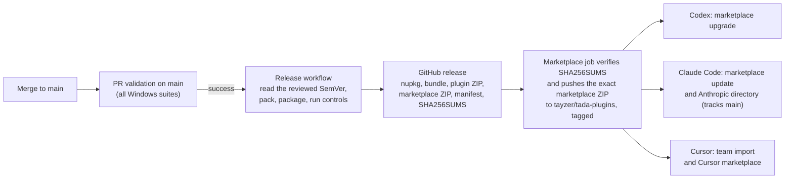

# Releasing TADA

Every push to `main` that passes full validation is published automatically ([ADR 0048](decisions/0048-publish-every-validated-main-build.md)). One build produces the CLI package, a download bundle, a plugin ZIP and a marketplace for Codex, Claude Code and Cursor. Merging a pull request is therefore the release decision.

## How it fits together



[`release.yml`](../.github/workflows/release.yml) starts when the **PR validation** workflow completes successfully for a push to `main`. It never runs for pull requests, merge-queue runs or failed validation.

1. It checks out the validated commit and confirms that the commit is on `main`. It reads the exact SemVer from `Directory.Build.props` and checks that all four plugin manifests agree.
2. It packs the CLI, then builds and checks the plugin, the marketplace and the download bundle with the same controls as CI.
3. It publishes a GitHub release tagged `v<version>`, with `release-manifest.json` (source commit, validation run, packaging run and asset hashes) and `SHA256SUMS`.
4. The `marketplace` job downloads the published assets, runs `sha256sum --check`, confirms the version and pushes the marketplace content unchanged to `tayzer/tada-plugins`, with the same tag.

Runs are serialised and queued, with up to 100 waiting, so every validated push is kept. Queue order can differ from merge order. GitHub’s latest release and marketplace `main` advance by SemVer. An older build that finishes late is still available by its tag.

## Versions

Choose one SemVer bump before completing each pull request. New releases use `MAJOR.MINOR.PATCH`.

| Change | Bump | Example from `0.2.0` |
| --- | --- | --- |
| Compatible fixes, docs or maintenance | Patch | `0.2.1` |
| Compatible features | Minor | `0.3.0` |
| Breaking release | Major | `1.0.0` |

Run the version setter and commit its five changes in the PR. For example, to select the patch above:

```powershell
pwsh -File scripts/Set-TadaVersion.ps1 -Version 0.2.1
pwsh -File scripts/Get-TadaReleaseVersion.ps1 -BaseCommit origin/main
```

The required `PR checks` result includes the version check. GitHub tests the proposed merge against its current base and reports the three allowed choices when the selection is invalid. If another PR lands first, bring the branch up to date and reselect the bump against the new base. The package, plugin manifests and GitHub tag all use the committed version. Historical alpha releases retain their prerelease tags and original versions.

Plugin setup automatically upgrades to a newer release in the same major/minor line, including upgrades from historical alpha builds. To adopt a new major or minor, follow the CLI install instructions in the matching [download bundle](../README.md#cli-only-no-agent-workflow) and run `dotnet tool update` in the existing repository with the matching version and bundle feed configuration. A newer CLI changes the tool manifest captured by the acceptance oracle. The next baseline needs human review and approval.

## One-time setup (done)

| Item | State |
| --- | --- |
| Marketplace repository | [`tayzer/tada-plugins`](https://github.com/tayzer/tada-plugins), public, filled only by automation |
| Deploy key | `TADA release automation`, write access to `tayzer/tada-plugins` only |
| Secret | `MARKETPLACE_DEPLOY_KEY` in the `tayzer/TADA` environment `marketplace` |
| Environment policy | `marketplace` releases its secret only to protected branches (`main`) |

To use a different marketplace repository, set the repository variable `MARKETPLACE_REPOSITORY` and update the install commands in the README.

> **Security:** The deploy key can write only to the marketplace repository. If it may have been exposed, delete it under `tayzer/tada-plugins` **Settings → Deploy keys**, generate a new pair with `ssh-keygen -t ed25519`, add the public key with write access, and replace the secret with `gh secret set MARKETPLACE_DEPLOY_KEY --env marketplace --repo tayzer/TADA < <private key file>`. Then delete the local key files.

## Republishing and recovery

- **Main validation timed out or failed:** inspect the failed suite and its retained evidence. Rerun failed jobs when the cause is transient. A successful retry of the original push validation triggers publication. If the cause requires a change, merge a fix and validate the new commit.
- **A release run failed after validation passed:** retry **Release** from `main` with the full commit SHA. The workflow finds successful push validation for that SHA and reads its committed version. For historical alpha commits it resolves the original run-number version and can retry the marketplace push for an existing release. An existing release for the same SHA must have all expected assets and checksums. The marketplace job reuses and verifies those published assets.
- **A bad build was published:** merge a fix. The next build supersedes it in every marketplace. Do not move or delete published tags; delete the GitHub release only if its assets must not be downloaded.
- **Pause publishing:** disable the **Release** workflow under **Actions**. Validation keeps running on `main`.

## Public directories

The directory listings are made by a person with the right account, not by automation. The [listing kit](listings.md) has the text, data-handling answers and checklists.

| Directory | Source it reads | Updates |
| --- | --- | --- |
| Anthropic plugin directory (Claude) | `tayzer/tada-plugins`, plugin path `tada`, tracking `main` | Each published build is scanned and published according to the publish setting |
| OpenAI plugin directory (Codex) | Upload of `TADA-plugin-<version>.zip`, which includes `.codex-plugin/plugin.json` | Upload a new build when the listing should move forward |
| Cursor marketplace | `tayzer/tada-plugins` | Managed by Cursor after approval |

## Later: NuGet.org

Publishing `Tada.Cli` to NuGet.org would let people install the CLI without a plugin. It needs the package ID reserved and an API key stored as a secret. The plugin would keep its bundled, checksummed verifier either way.
